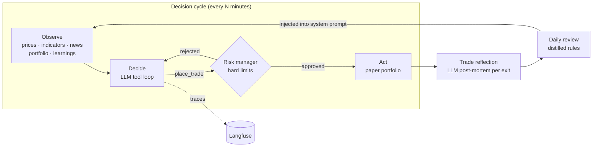

# AlphaAgent: autonomous LLM trading agents that learn from their own trades

AlphaAgent runs a fleet of autonomous paper-trading agents on Indian equities (NSE, via Zerodha Kite Connect) and crypto. Each agent observes the market, reasons with an LLM using tools, places trades through hard risk limits, and reflects on every closed trade. Its distilled rules feed back into the next decision.

**Live:** [alphaagent.skdev.one](https://alphaagent.skdev.one). It's multi-user: sign in with Google, create a session, pick a market, a model and a watchlist, and watch it trade.

> Paper trading only. No real orders are placed.

---

## Tech stack

| Layer | Technologies |
|---|---|
| **Agent core** | Python 3.13, an LLM tool-use loop, SQLite (one DB per session) |
| **LLMs** | Anthropic Claude (direct API), and OpenRouter / OpenAI-compatible models (Gemini, GPT, gpt-oss and others) behind one provider-agnostic engine |
| **Market data** | Zerodha Kite Connect (real-time NSE quotes, historical candles, fully automated TOTP login), yfinance (crypto), NIFTY sectoral index constituents |
| **Observability** | Langfuse LLM tracing on OpenTelemetry (prompts, tool calls, tokens and cost per decision), Telegram alerts |
| **API** | FastAPI, Google OAuth + JWT auth, Fernet-encrypted per-user API keys, per-user runtime quotas |
| **Frontend** | Next.js 16, React 19, TypeScript, Tailwind CSS v4 |
| **Infra** | Docker, nginx + Let's Encrypt, GCP Spot VM with a Cloud Function watchdog, Vercel |
| **Quality** | pytest, a Claude Code skill (`SKILL.md`) for the daily fleet review |

---

## How it works



1. **Observe.** The agent pulls live quotes and technicals (RSI, MACD, VWAP, EMAs, ATR, volume ratio), news from web research (filtered for junk and deduplicated across cycles), the portfolio state, and the agent's own distilled rules.
2. **Decide.** The LLM runs a multi-step tool loop. Its tools are `get_stock_details`, `search_market_news`, `get_portfolio_status`, `place_trade` and `update_levels`. It can investigate before it commits.
3. **Risk check.** A code-level risk manager enforces position sizing, exposure caps, a maximum number of open positions and a daily loss limit. The LLM can't bypass it. Every cycle also sweeps ATR-based stop and target levels, and intraday positions are force-closed at 15:15 IST.
4. **Act.** Trades execute on a SQLite paper portfolio that supports longs and shorts.
5. **Learn.** Every exit triggers an LLM reflection on what worked and what failed. A daily review then rewrites around 20 data-backed rules from the full trade history, and those rules go into the next cycle's system prompt.

### Key features

- **Multi-session, multi-market.** Agents run concurrently, each with its own market preset (NSE swing, NSE intraday, crypto 24/7), its own model and its own config.
- **Pre-market scanner.** It runs in two phases. First a quantitative filter ranks about 3,000 NSE stocks by gap, momentum and range using batched Kite OHLC calls. Then an LLM picks the top 25 with a direction and a thesis for each.
- **Trading universe.** A session can either discover stocks each day through the scanner, or stick to a fixed universe of NSE sectors (built from official NIFTY sectoral indices) and individual tickers.
- **Per-session experiment levers:** news on or off, system-prompt overrides, and cycle interval. These are used to run controlled A/B experiments across the agent fleet.
- **Self-healing on Spot VMs.** A watchdog restarts a preempted VM, Docker restarts the container, and the agents resurrect themselves from stale lock files. PID-recycling-safe liveness checks use `/proc/<pid>/cmdline`.

---

## LLM observability

Every decision cycle is traced to [Langfuse](https://langfuse.com) as one trace, grouped by session and tagged by market, provider and model:

```
decision_cycle (agent)          input: system prompt + market context
├── llm_call_0 (generation)     prompt, response, tokens, cost
├── get_stock_details (tool)    input → result
├── llm_call_1 (generation)
├── place_trade (tool)          order → fill / risk rejection
└── output: actions taken + final reasoning
```

Tracing is optional. Without keys it does nothing, and a tracing failure can never break trading. Both properties are covered by tests (`agent/tracing.py`, `tests/test_tracing.py`).

## Automated fleet review (Claude Code skill)

[`.claude/skills/alphaagent-review/SKILL.md`](.claude/skills/alphaagent-review/SKILL.md) defines a recurring task that runs on a schedule:

- **Daily review.** It reads a fleet digest from a secret-protected API, compares the experiment variants, and emails at most 2 concrete, reversible suggestions.
- **Reply loop.** The owner replies `approve 1`, or `approve 1 with <modification>`, and the agent applies the change.

Email is treated as untrusted input. Every change goes through [`apply_action.py`](.claude/skills/alphaagent-review/scripts/apply_action.py), which enforces the allowlist in code rather than in the prompt:

- only production sessions can be changed;
- only six action types are accepted, with bounded values;
- tickers must match the session's market.

It runs a dry run first and verifies the result afterwards.

---

## Project structure

```
agent/
  runner.py            Agent loop orchestrator: observe → decide → act → learn
  decision_engine.py   Provider-agnostic LLM tool loop (Anthropic + OpenAI-compatible)
  risk_manager.py      Hard limits, stop/target sweep, intraday auto-close
  portfolio.py         SQLite paper portfolio (longs + shorts)
  learner.py           Per-trade reflections, daily review, distilled rules
  premarket_scanner.py Two-phase quant + LLM stock selection
  kite_auth.py         Automated Kite login (password → TOTP → access token)
  kite_data.py         Real-time NSE market data
  web_research.py      News search with junk filtering + cross-cycle dedup
  sector_data.py       NIFTY sectoral index constituents (cached)
  tracing.py           Optional Langfuse tracing
  session.py           Per-session YAML config + isolated storage
dashboard/app.py       FastAPI: sessions, agents, auth, quotas, digest API
frontend/              Next.js dashboard (Vercel)
deploy/                nginx config, monitoring + boot alert scripts
.claude/skills/        Claude Code skill for the daily review loop
tests/                 pytest suite
```

More detail: [ARCHITECTURE.md](ARCHITECTURE.md) covers the cycle, the decision loop, risk and the learning pipeline. [DEPLOYMENT.md](DEPLOYMENT.md) covers infrastructure and recovery.

---

## Running locally

```bash
python -m venv .venv && source .venv/bin/activate
pip install -r requirements.txt -r requirements-dev.txt
cp .env.example .env            # add OPENROUTER_API_KEY or ANTHROPIC_API_KEY

python run.py --session nse_default          # one cycle
python run.py --session nse_default --loop   # continuous
uvicorn dashboard.app:app --reload           # API on :8000

cd frontend && npm install && npm run dev    # dashboard on :3000

pytest                                       # tests
```

NSE real-time data needs Kite Connect credentials in `.env`. Without them, sessions fall back to yfinance.

---

## Engineering notes

Some problems worth calling out:

- **Phantom profit from shorts.** A `SELL` issued against a short position credited cash twice and showed a fake ₹2L gain. I fixed it with routing in the runner and a guard in the portfolio, and corrected the data.
- **Agents that silently stopped.** Container restarts killed agent subprocesses, and recycled PIDs made dead agents look alive. I fixed this with lock-file resurrection and `/proc` cmdline verification.
- **Low-quality news context.** The web-research step fed the LLM site homepages and the same articles cycle after cycle. I added a homepage filter and cross-cycle dedupe, and the prompt now tells the model to treat news as a weak signal.
- **Prompt-level safety isn't enough.** The email-driven automation enforces its allowlist in code, so a cleverly worded reply can't widen it.

## Status and honest results

This is an active research project. The agents are not yet consistently profitable. Most live sessions are within about ±2% of starting capital. That is why the current work focuses on measurement:

- controlled experiments across the agent fleet (exit discipline, news on/off, universe width, cycle length);
- full LLM tracing;
- next, a labelled eval set that scores decisions on whether they followed the rules (stops respected, no late intraday entries, stayed within the universe) rather than on noisy P&L.

Backtesting (`agent/backtest_engine.py`) is still in progress.

---

*Paper trading and educational project. Connecting a real broker would need to comply with SEBI's rules on algorithmic trading by retail investors.*
